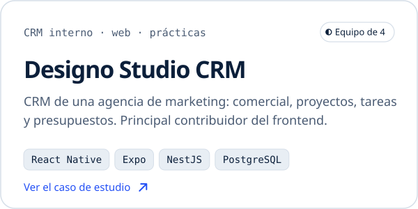
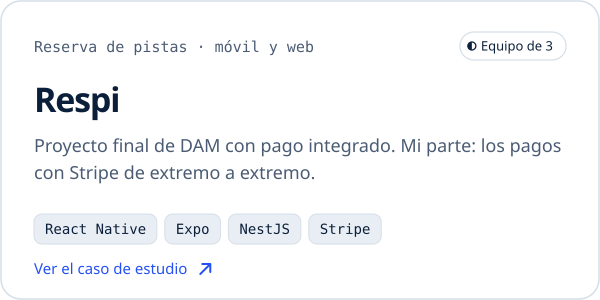
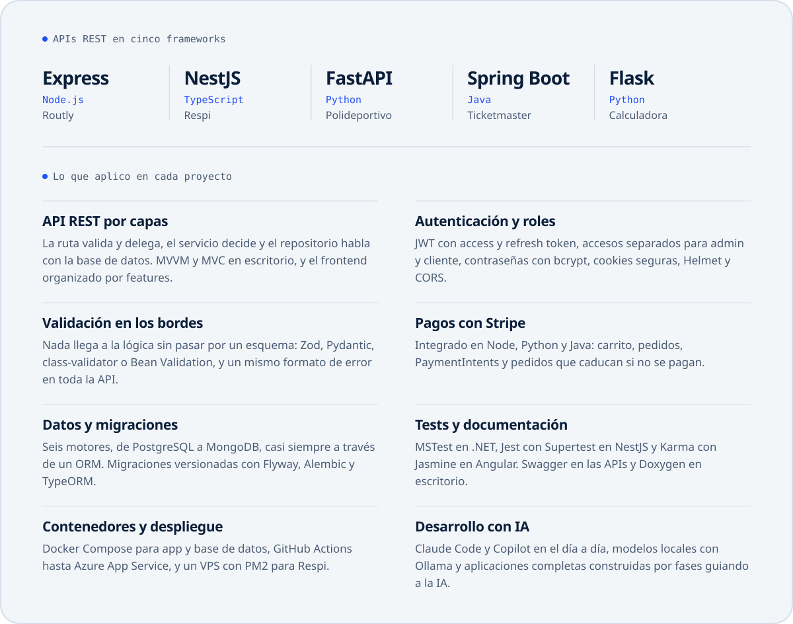
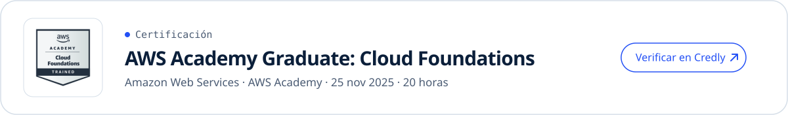

<a href="https://mauro-vs.dev">
  <picture>
    <source media="(prefers-color-scheme: dark)" srcset="assets/hero-dark.svg">
    <source media="(prefers-color-scheme: light)" srcset="assets/hero-light.svg">
    
  </picture>
</a>

  <a href="https://mauro-vs.dev"><picture><source media="(prefers-color-scheme: dark)" srcset="assets/portfolio-dark.svg"></picture></a>&nbsp;
  <a href="mailto:hello@mauro-vs.dev"><picture><source media="(prefers-color-scheme: dark)" srcset="assets/email-dark.svg"></picture></a>&nbsp;
  <a href="https://www.linkedin.com/in/mauro-vs/"><picture><source media="(prefers-color-scheme: dark)" srcset="assets/linkedin-dark.svg"></picture></a>&nbsp;
  <a href="https://mauro-vs.dev/cv-mauro-valdes.pdf"><picture><source media="(prefers-color-scheme: dark)" srcset="assets/cv-dark.svg"></picture></a>

### Hola, soy Mauro.

Terminé el ciclo de **DAM** y estoy cursando 2º de **DAW**. En mis prácticas en Designo Studio fui el principal contribuidor del frontend del CRM interno, en un equipo de cuatro.

Me interesa el recorrido completo: el modelo de datos, la API y la pantalla que la usa. Busco un puesto **full-stack** donde aportar desde el primer día, en **remoto, híbrido o presencial**.

 

### Proyectos

  <a href="https://mauro-vs.dev/proyectos/designo-crm/"><picture><source media="(prefers-color-scheme: dark)" srcset="assets/designo-crm-dark.svg"></picture></a>
  <a href="https://mauro-vs.dev/proyectos/respi/"><picture><source media="(prefers-color-scheme: dark)" srcset="assets/respi-dark.svg"></picture></a>
  <a href="https://mauro-vs.dev/proyectos/gestilibro/"><picture><source media="(prefers-color-scheme: dark)" srcset="assets/gestilibro-dark.svg"></picture></a>
  <a href="https://mauro-vs.dev/proyectos/hakuna-mamoto/"><picture><source media="(prefers-color-scheme: dark)" srcset="assets/hakuna-mamoto-dark.svg"></picture></a>
  <a href="https://mauro-vs.dev/proyectos/club-padel/"><picture><source media="(prefers-color-scheme: dark)" srcset="assets/club-padel-dark.svg"></picture></a>
  <a href="https://github.com/Mauro-vs/Proyecto_API"><picture><source media="(prefers-color-scheme: dark)" srcset="assets/motogp-dark.svg"></picture></a>

**Código.** Propios: [GestiLibro](https://github.com/Mauro-vs/GestiLibro) · [Hakuna MaMoto](https://github.com/Mauro-vs/Hakuna-MaMoto) · [Club Pádel](https://github.com/Mauro-vs/ClubPadel) · [MotoGP Dashboard](https://github.com/Mauro-vs/Proyecto_API) 
En equipo: Designo Studio CRM ([frontend](https://github.com/Yonderus/Designo-Studio-Front), [API](https://github.com/Yonderus/Designo-Studio-Back)) · Respi ([app](https://github.com/Christopher-Blc/Respi_Frontend), [API](https://github.com/Christopher-Blc/ProyectoApp_Acceso_A_Datos)), liderado por [@Christopher-Blc](https://github.com/Christopher-Blc)

 

### Stack

<picture>
  <source media="(prefers-color-scheme: dark)" srcset="assets/stack-dark.svg">
  
</picture>

  

### Cómo trabajo

<picture>
  <source media="(prefers-color-scheme: dark)" srcset="assets/practices-dark.svg">
  
</picture>

  

### Certificación

<a href="https://www.credly.com/badges/16754b15-13c8-4480-b799-79a8f6901bdd/public_url">
  <picture>
    <source media="(prefers-color-scheme: dark)" srcset="assets/certification-dark.svg">
    
  </picture>
</a>

  

### En números

<picture>
  <source media="(prefers-color-scheme: dark)" srcset="assets/stats-dark.svg">
  
</picture>

Se genera cada día con una GitHub Action a partir de la API de GitHub.
