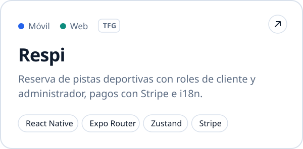
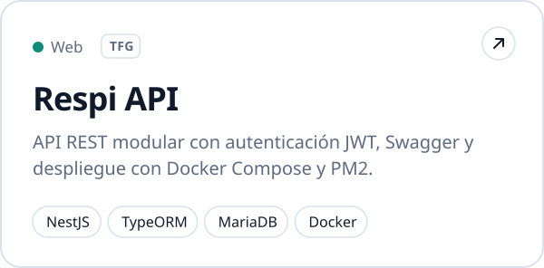
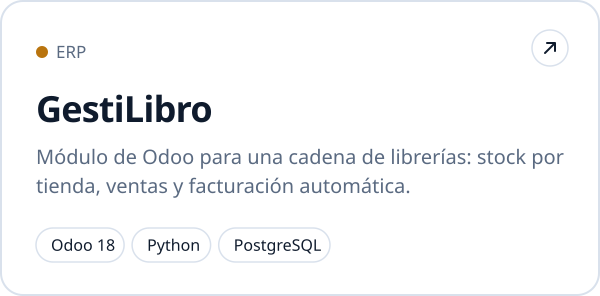
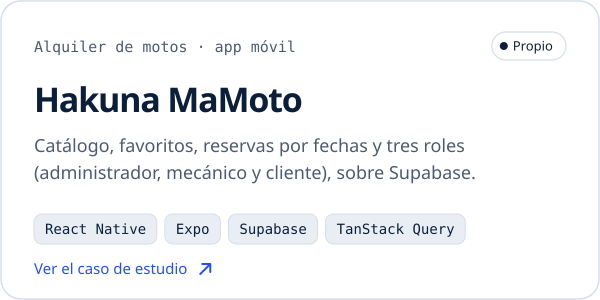
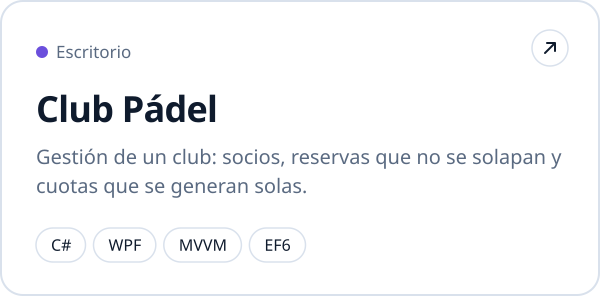
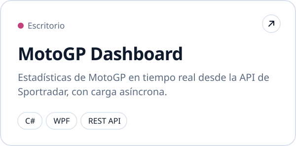
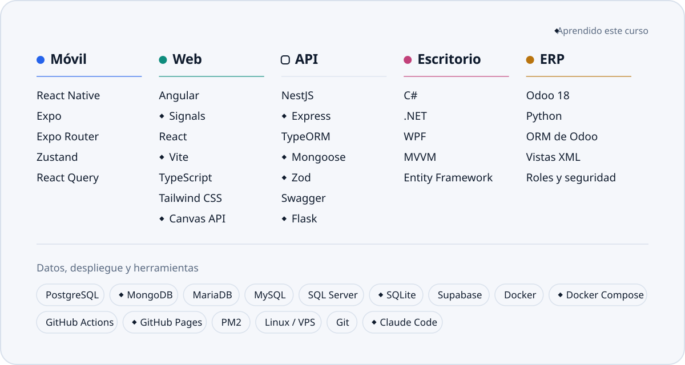
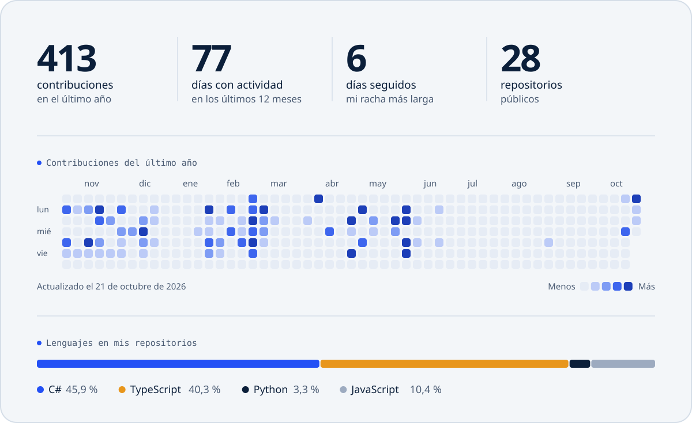

<picture>
  <source media="(prefers-color-scheme: dark)" srcset="assets/hero-dark.svg">
  <source media="(prefers-color-scheme: light)" srcset="assets/hero-light.svg">
  
</picture>

  <a href="https://www.linkedin.com/in/mauro-vs/"><picture><source media="(prefers-color-scheme: dark)" srcset="assets/linkedin-dark.svg"></picture></a>&nbsp;
  <a href="mailto:maurovs19@gmail.com"><picture><source media="(prefers-color-scheme: dark)" srcset="assets/email-dark.svg"></picture></a>

Soy Técnico Superior en **Desarrollo de Aplicaciones Multiplataforma** y ahora curso DAW. Me gusta llevar un proyecto de punta a punta: la app en React Native, la API en NestJS que hay detrás, el despliegue en un VPS con Docker y GitHub Actions y, si la empresa trabaja con Odoo, el módulo que lo une todo.

Hice las prácticas en **Designo Studio**, una agencia digital de Valencia, construyendo herramientas internas de generación de contenido con React y Sanity, y webs de clientes en WordPress y Shopify.

**Ahora mismo** estoy con Routly, una plataforma de rutas en moto: API REST en Express con MongoDB y Zod, y panel de administración en Angular 20.
**Este curso** he sumado Express, MongoDB, Angular Signals, Vite, Flask, Docker Compose y GitHub Pages, y desarrollo con agentes de IA como Claude Code.
**Siguiente**: Flutter y la nube (AWS, Azure y Google Cloud).

 

### Proyectos

  <a href="https://github.com/Christopher-Blc/Respi_Frontend"><picture><source media="(prefers-color-scheme: dark)" srcset="assets/respi-app-dark.svg"></picture></a>
  <a href="https://github.com/Christopher-Blc/ProyectoApp_Acceso_A_Datos"><picture><source media="(prefers-color-scheme: dark)" srcset="assets/respi-api-dark.svg"></picture></a>
  <a href="https://github.com/Mauro-vs/GestiLibro"><picture><source media="(prefers-color-scheme: dark)" srcset="assets/gestilibro-dark.svg"></picture></a>
  <a href="https://github.com/Mauro-vs/Hakuna-MaMoto"><picture><source media="(prefers-color-scheme: dark)" srcset="assets/hakuna-mamoto-dark.svg"></picture></a>
  <a href="https://github.com/Mauro-vs/ClubPadel"><picture><source media="(prefers-color-scheme: dark)" srcset="assets/club-padel-dark.svg"></picture></a>
  <a href="https://github.com/Mauro-vs/Proyecto_API"><picture><source media="(prefers-color-scheme: dark)" srcset="assets/motogp-dark.svg"></picture></a>

Respi es mi proyecto de fin de ciclo, desarrollado en equipo con <a href="https://github.com/Christopher-Blc">@Christopher-Blc</a>.

  

### Con qué trabajo

<picture>
  <source media="(prefers-color-scheme: dark)" srcset="assets/stack-dark.svg">
  
</picture>

  

### En números

<picture>
  <source media="(prefers-color-scheme: dark)" srcset="assets/stats-dark.svg">
  
</picture>

Se genera cada día con una GitHub Action a partir de la API de GitHub.
